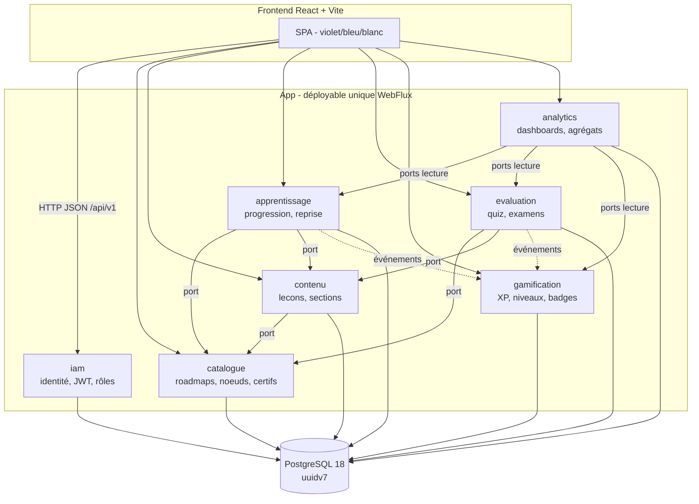
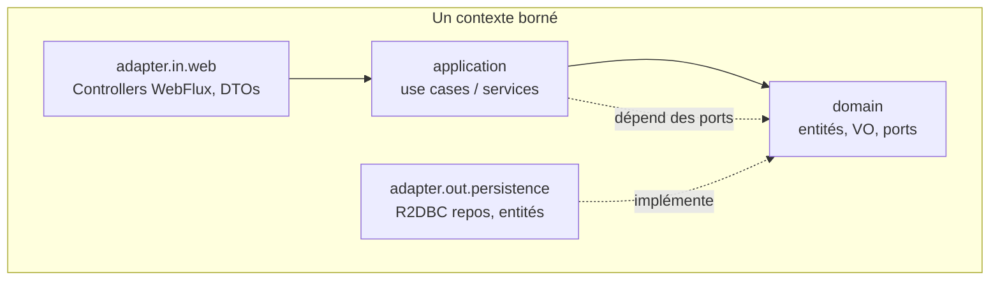

# ARCHITECTURE TECHNIQUE — SkillForge

> **Statut :** document ancre (v1). Avec `docs/SPECIFICATION.md`, cette architecture est
> réinjectée dans tous les travaux suivants. Priorité en cas de conflit (cf. `CLAUDE.md` §11) :
> décisions validées > `ARCHITECTURE.md` / `SPECIFICATION.md` > `CLAUDE.md` > suppositions.

---

## 1. Vue d'ensemble

**Monolithe modulaire** : un seul déployable local, découpé en **contextes bornés** aux
frontières nettes, chacun en **architecture hexagonale** (ports & adapters). Stack
**réactive de bout en bout** : Java 21, Spring Boot 4.1 (Spring Framework 7), WebFlux,
Spring Security réactif + JWT, Spring Data R2DBC (`r2dbc-postgresql`), PostgreSQL 18
(UUID v7 natif), migrations Flyway (JDBC au démarrage uniquement), build **Maven
multi-modules**.

### 1.1 Schéma des contextes, dépendances autorisées & flux



**Règles de dépendance entre contextes :**
- Les flèches pleines = appels synchrones **via un port exposé** (jamais d'accès direct aux
  tables d'un autre contexte).
- Les flèches pointillées = communication **par événements** (découplage) : les faits
  d'apprentissage/évaluation notifient `gamification`, qui attribue XP/niveaux/badges.
- `analytics` est en **lecture seule** sur des ports d'agrégation exposés par les autres
  contextes ; il ne modifie rien.
- `iam` est transverse : il fournit l'identité authentifiée (via le contexte de sécurité
  réactif) mais n'est pas appelé métier-à-métier ; les autres contextes reçoivent le
  `userId` déjà authentifié.

### 1.2 Dépendances internes d'un contexte (règle hexagonale)



Les dépendances pointent **vers l'intérieur** : `adapter → application → domain`. Le
**domaine ne dépend de rien** (ni Spring, ni R2DBC, ni web) : il **définit des ports**
(interfaces) que les adaptateurs sortants **implémentent**.

---

## 2. Patron hexagonal de référence — contexte `apprentissage`

Ce contexte (cœur du produit : progression, navigation non linéaire, reprise exacte) sert
de **patron à tous les autres**. Arborescence de packages détaillée :

```
apprentissage/
  domain/
    model/
      Enrollment.java              # agrégat : lien user↔roadmap + état de reprise
      LessonProgress.java          # VO : statut d'une leçon (VUE / COMPLETEE)
      NodeProgress.java            # VO : % + dernière leçon consultée d'un nœud
      RoadmapProgress.java         # VO : dernier nœud actif + % du parcours
      Bookmark.java                # entité : marque-page (nœud ou leçon)
      Streak.java                  # VO : série de jours d'activité
      ProgressStatus.java          # enum : NOT_STARTED / IN_PROGRESS / COMPLETED
      LearnerId.java NodeId.java LessonId.java RoadmapId.java  # VO identifiants typés
    event/
      LessonCompletedEvent.java    # événement de domaine (consommé par gamification)
      NodeCompletedEvent.java
    port/
      in/
        EnrollLearnerUseCase.java
        MarkLessonViewedUseCase.java
        CompleteLessonUseCase.java
        ResumeLastUseCase.java
        ToggleBookmarkUseCase.java
        GetRoadmapProgressUseCase.java
      out/
        EnrollmentRepository.java  # port de persistance (interface pure)
        ProgressRepository.java
        BookmarkRepository.java
        StreakRepository.java
        CatalogueQueryPort.java    # port vers catalogue (nœuds/leçons existent ?)
        LearningEventPublisher.java# port de publication d'événements
    exception/
      AlreadyEnrolledException.java
      EnrollmentNotFoundException.java
      LessonNotInNodeException.java
  application/
    EnrollLearnerService.java      # implémente EnrollLearnerUseCase
    MarkLessonViewedService.java
    CompleteLessonService.java
    ResumeLastService.java
    ToggleBookmarkService.java
    GetRoadmapProgressService.java
  adapter/
    in/web/
      LearningController.java      # @RestController WebFlux, /api/v1/...
      dto/
        EnrollRequest.java EnrollResponse.java
        ProgressResponse.java ResumeResponse.java BookmarkRequest.java
      mapper/
        LearningWebMapper.java     # DTO ↔ commande/résultat (hors domaine)
    out/persistence/
      entity/
        EnrollmentEntity.java      # entité R2DBC (table enrollments)
        LessonProgressEntity.java NodeProgressEntity.java
        BookmarkEntity.java StreakEntity.java
      repository/
        EnrollmentR2dbcRepository.java   # extends ReactiveCrudRepository
        ProgressR2dbcRepository.java
        BookmarkR2dbcRepository.java StreakR2dbcRepository.java
      adapter/
        EnrollmentRepositoryAdapter.java # implémente le port domain.port.out
        ProgressRepositoryAdapter.java
        BookmarkRepositoryAdapter.java StreakRepositoryAdapter.java
      mapper/
        LearningPersistenceMapper.java   # domaine ↔ entité (hors domaine)
    out/event/
      SpringLearningEventPublisher.java  # implémente LearningEventPublisher
    out/catalogue/
      CatalogueQueryAdapter.java   # implémente CatalogueQueryPort (appelle le port exposé par catalogue)
  config/
    LearningBeansConfig.java       # câblage des beans (ports → adapters)
```

**À retenir pour répliquer ce patron :**
- `domain/` = pur (aucun import Spring/R2DBC/web). Contient `model/`, `event/`, `port/in`,
  `port/out`, `exception/`.
- `application/` = un service par use case, nommé par l'intention, implémente le port `in`.
- `adapter/in/web/` = controller + DTOs + mapper web.
- `adapter/out/persistence/` = entité R2DBC + repository Spring Data + **adapter** qui
  implémente le port `out` + mapper de persistance.
- Le **mapping** (DTO↔commande, domaine↔entité) reste **hors du domaine**.

---

## 3. Conventions transverses

### 3.1 Nommage
- Classes `PascalCase`, méthodes/variables `camelCase`, packages en minuscules.
- Use cases nommés par l'**intention** : `EnrollLearnerUseCase`, `MarkLessonViewedUseCase`.
- Services applicatifs : `<UseCase>Service`. Adaptateurs de persistance : `<X>RepositoryAdapter`.
- Ports sortants : `<X>Repository`, `<X>QueryPort`, `<X>Publisher`. Ports entrants : `<Intent>UseCase`.
- Entités R2DBC : suffixe `Entity`. DTOs web : suffixe `Request`/`Response`.
- VO identifiants **typés** (`LearnerId`, `NodeId`…) plutôt que `UUID` nu dans le domaine.

### 3.2 Réactif
- Retourner `Mono<T>` / `Flux<T>`. **Jamais `.block()`** dans le runtime, **jamais d'I/O
  bloquante** dans un pipeline réactif (JDBC toléré uniquement pour Flyway au démarrage).
- Privilégier `record` pour VO, DTOs, commandes. Éviter `null` : `Mono` vide ou exception
  de domaine explicite.

### 3.3 Gestion des UUID v7
- **PK générées en base** : `uuid DEFAULT uuidv7()` (fonction native PostgreSQL 18).
- Si un ID doit être connu **avant** insertion (rare) : génération **côté Java avec une lib
  v7** (`com.github.f4b6a3:uuid-creator`), **jamais `UUID.randomUUID()`** (v4).
- Ne pas exposer un UUID v7 comme identifiant public si la date de création est sensible
  (l'horodatage y est encodé).

### 3.4 Mapping domaine ↔ persistance ↔ web
- Deux frontières de mapping, toutes deux **hors du domaine** :
  - **web** : `DTO ↔ commande/résultat` dans `adapter/in/web/mapper/`.
  - **persistance** : `domaine ↔ entité R2DBC` dans `adapter/out/persistence/mapper/`.
- Mapping **manuel** (records + mappers simples) privilégié ; MapStruct optionnel si le
  volume le justifie. Aucune entité de persistance ni DTO ne fuit dans le domaine.

### 3.5 Gestion des erreurs réactive (centralisée)
- Exceptions de **domaine** explicites (`AlreadyEnrolledException`, etc.) traduites en codes
  HTTP par un **handler global réactif** (`@RestControllerAdvice` réactif ou
  `WebExceptionHandler`).
- **Jamais** de stacktrace renvoyée au client. Bloc d'erreur normalisé (cf. §3.6).
- Mapping de codes : `400` validation, `401/403` auth, `404` introuvable, `409` conflit,
  `422` règle métier, `500` inattendu.

### 3.6 Format des réponses API (enveloppe standard)
- Chemins REST versionnés : `/api/v1/<ressource>` (ressources au **pluriel**).
- Enveloppe unique réutilisée partout :

```jsonc
// Succès
{
  "data": { /* payload */ },
  "meta": { "page": 0, "size": 20, "total": 137 }, // présent si pagination
  "error": null
}
// Erreur
{
  "data": null,
  "meta": null,
  "error": {
    "code": "ALREADY_ENROLLED",        // code métier stable
    "message": "Apprenant déjà inscrit à ce parcours.",
    "details": []                       // erreurs de validation champ par champ, le cas échéant
  }
}
```

- Codes succès : `200` / `201` (création) / `204` (sans corps).
- Validation des entrées **au bord** (adaptateur web), pas dans le domaine.
- Documentation **OpenAPI** générée et accessible en local.

---

## 4. Build : Maven multi-modules

**Choix : Maven multi-modules** (cf. ADR-0002) — POM parent + un module par brique. Un
module par contexte borné garantit l'isolation des dépendances et matérialise les
frontières.

### 4.1 Liste des modules

```
skillforge/                     (pom parent, packaging=pom)
├── app/                        # module d'assemblage : main Spring Boot, config globale,
│                               #   sécurité réactive, handler d'erreurs, OpenAPI, Flyway
├── common/                     # noyau partagé SANS logique métier : enveloppe API,
│                               #   erreurs de base, utilitaires UUID v7, types communs
├── iam/                        # contexte borné (hexagonal)
├── catalogue/                  # contexte borné
├── contenu/                    # contexte borné
├── apprentissage/              # contexte borné (référence)
├── evaluation/                 # contexte borné
├── gamification/               # contexte borné
└── analytics/                  # contexte borné
```

**Règles de dépendances Maven :**
- `app` dépend de tous les contextes (assemblage) ; c'est le seul module exécutable.
- Chaque contexte dépend de `common` uniquement (jamais d'un autre contexte en dépendance
  directe de compilation ; les échanges inter-contextes passent par des **ports** dont les
  interfaces vivent côté consommateur, l'adaptateur étant câblé dans `app` ou via un module
  d'API partagé minimal si nécessaire).
- `common` ne dépend d'aucun contexte.
- Versions gérées dans le `dependencyManagement` du POM parent (Spring Boot BOM 4.1).

### 4.2 Découpage interne d'un module contexte
Voir §2 : `domain / application / adapter(in.web, out.persistence, out.event, out.<autre>) / config`.

---

## 5. Décisions d'architecture (ADR)

Les décisions structurantes sont consignées dans `docs/adr/` (format court). Résumé :

| ADR | Décision | Statut |
|---|---|---|
| [0001](adr/0001-reactif-vs-bloquant.md) | Réactif de bout en bout (WebFlux + R2DBC), pas de stack bloquante | Accepté |
| [0002](adr/0002-monolithe-modulaire.md) | Monolithe modulaire (pas de microservices) | Accepté |
| [0003](adr/0003-uuid-v7-en-base.md) | UUID v7 générés en base (`DEFAULT uuidv7()`) | Accepté |
| [0004](adr/0004-jwt-stateless.md) | Authentification JWT stateless (access + refresh) | Accepté |
| [0005](adr/0005-migrations-flyway.md) | Migrations via Flyway (JDBC au démarrage) | Accepté |

---

## 6. Configuration & profils (aperçu)
- `application.yml` : datasource **R2DBC** (`r2dbc:postgresql://...`) pour le runtime +
  datasource **JDBC** dédiée à Flyway (démarrage uniquement).
- Profils `local` et `docker`.
- Secrets via variables d'environnement (jamais en dur) ; `.env.example` documenté.
- Enveloppe de réponse standard + handler d'erreurs global définis dans `app`/`common`.

---

> **Prochain jalon :** dériver `BACKLOG.md` (epics → user stories priorisées) à partir de la
> spécification et de cette architecture, puis attaquer le socle backend (modèle de données
> & migrations Flyway) en respectant le flux WIP = 1.
