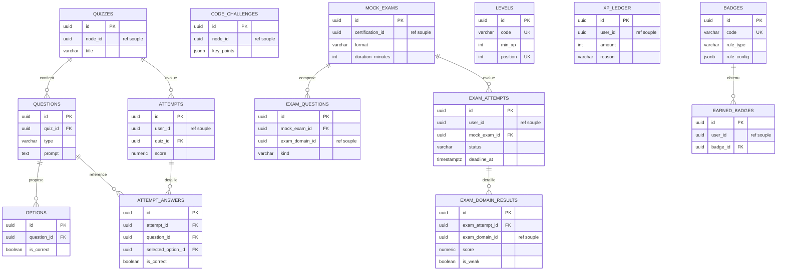

# MODÈLE DE DONNÉES — SkillForge

> Modèle physique PostgreSQL 18 et migrations Flyway. Dérivé de `docs/SPECIFICATION.md`
> (§4) et `docs/ARCHITECTURE.md`. Les migrations vivent dans
> `app/src/main/resources/db/migration/` (emplacement Flyway standard, repris par le
> module `app`).
>
> **Avancement :** ✅ SF-10a (cœur : iam, catalogue, contenu, apprentissage) ·
> ✅ SF-10b (evaluation, gamification) · ✅ SF-10c (seed `V8`). **SF-10 terminé.**

---

## 1. Conventions transverses du schéma

- **Clés primaires :** `uuid` avec `DEFAULT uuidv7()` — **générées en base** (PostgreSQL 18,
  fonction native, aucune extension). Voir `docs/adr/0003-uuid-v7-en-base.md`.
- **Audit :** chaque table métier porte `created_at` et `updated_at` (`timestamptz`,
  `DEFAULT now()`). `updated_at` est maintenu par le trigger `set_updated_at()` (défini en
  `V1`). Les tables purement associatives/append-only (`user_roles`, `refresh_tokens`,
  `edges`, `bookmarks`, `node_exam_domains`) n'ont pas d'`updated_at`.
- **Frontières de contexte :**
  - **FK dures** uniquement **à l'intérieur** d'un contexte (ex. `sections.lesson_id →
    lessons.id`).
  - **Références souples** (colonne `uuid` **sans** contrainte FK, mais **indexée**) pour
    tout lien **inter-contexte** (ex. `lessons.node_id` → catalogue, `enrollments.user_id`
    → iam). C'est un choix DDD assumé : chaque contexte reste autonome, référence les autres
    **par identifiant**, et l'intégrité inter-contexte est garantie par la couche
    application (ports), pas par le SGBD. Cela permet aussi d'appliquer/faire évoluer les
    migrations d'un contexte sans coupler physiquement les tables d'un autre.
- **Énumérations :** encodées en `varchar` + `CHECK (... IN (...))` (lisibles, sans type
  enum PostgreSQL à faire évoluer par migration).
- **Index :** systématiques sur les FK et sur les colonnes de tri/filtre fréquentes
  (ex. `enrollments(user_id, last_activity_at DESC)` pour la reprise globale).

---

## 2. Notes sur UUID v7

- **Avantage d'index :** un UUID v7 encode un horodatage en tête → les valeurs sont
  **quasi-ordonnées dans le temps**, ce qui réduit la fragmentation des index B-tree par
  rapport à un UUID v4 aléatoire (meilleure localité d'insertion).
- **Génération :** en base via `DEFAULT uuidv7()`. L'ID nominal est donc connu **après**
  insertion (`RETURNING id`). Si un ID doit être connu **avant** insertion, le générer côté
  Java avec `com.github.f4b6a3:uuid-creator` — **jamais `UUID.randomUUID()`** (v4).
- **Précaution vie privée :** la **date de création est déduisible** d'un UUID v7. Ne pas
  l'exposer comme identifiant public là où cet horodatage serait sensible.

---

## 3. Migrations

| Fichier | Contexte | Tables |
|---|---|---|
| `V1__baseline.sql` | partagé | fonction trigger `set_updated_at()` |
| `V2__iam.sql` | iam | `roles`, `users`, `user_roles`, `refresh_tokens` |
| `V3__catalogue.sql` | catalogue | `roadmaps`, `certifications`, `exam_domains`, `phases`, `nodes`, `edges`, `node_exam_domains` |
| `V4__contenu.sql` | contenu | `lessons`, `sections` |
| `V5__apprentissage.sql` | apprentissage | `enrollments`, `node_progress`, `lesson_progress`, `bookmarks`, `streaks` |
| `V6__evaluation.sql` | evaluation | `quizzes`, `questions`, `options`, `attempts`, `attempt_answers`, `code_challenges`, `mock_exams`, `exam_questions`, `exam_attempts`, `exam_domain_results` |
| `V7__gamification.sql` | gamification | `levels`, `xp_ledger`, `badges`, `earned_badges` |
| `V8__seed_demo.sql` | seed | référence (3 rôles, 6 niveaux, 6 badges) + démo (2 users, parcours "Backend", quiz, progression) |

> `V2`→`V7` sont du **DDL pur**. Les données de référence (rôles, paliers de niveau,
> badges) et la démo sont chargées par le **seed** `V8` (idempotent, `ON CONFLICT DO NOTHING`).
> **Total : 32 tables.** Comptes de démo : `admin@skillforge.dev` / `learner@skillforge.dev`
> (mot de passe `Skillforge123!`).

---

## 4. Diagramme entité-relation (périmètre SF-10a)

Les liens **inter-contextes** (souples) sont notés en pointillés `..>` ; les FK dures en
traits pleins.

```mermaid
erDiagram
    %% ---------- IAM ----------
    ROLES {
        uuid id PK
        varchar code UK
        varchar label
    }
    USERS {
        uuid id PK
        varchar email UK
        varchar password_hash
        varchar display_name
        boolean enabled
    }
    USER_ROLES {
        uuid user_id PK_FK
        uuid role_id PK_FK
    }
    REFRESH_TOKENS {
        uuid id PK
        uuid user_id FK
        varchar token_hash UK
        timestamptz expires_at
        boolean revoked
    }
    USERS ||--o{ USER_ROLES : a
    ROLES ||--o{ USER_ROLES : attribue
    USERS ||--o{ REFRESH_TOKENS : possede

    %% ---------- CATALOGUE ----------
    ROADMAPS {
        uuid id PK
        varchar slug UK
        varchar title
        varchar kind
    }
    CERTIFICATIONS {
        uuid id PK
        uuid roadmap_id FK
        varchar code UK
        varchar exam_format
        int duration_minutes
    }
    EXAM_DOMAINS {
        uuid id PK
        uuid certification_id FK
        varchar name
        numeric weight
    }
    PHASES {
        uuid id PK
        uuid roadmap_id FK
        varchar title
        int position
    }
    NODES {
        uuid id PK
        uuid roadmap_id FK
        uuid phase_id FK
        varchar slug
        varchar importance
    }
    EDGES {
        uuid id PK
        uuid roadmap_id FK
        uuid source_node_id FK
        uuid target_node_id FK
        varchar kind
    }
    NODE_EXAM_DOMAINS {
        uuid node_id PK_FK
        uuid exam_domain_id PK_FK
        numeric weight
    }
    ROADMAPS ||--o{ CERTIFICATIONS : "prepare (si certif)"
    ROADMAPS ||--o{ PHASES : contient
    ROADMAPS ||--o{ NODES : contient
    ROADMAPS ||--o{ EDGES : relie
    PHASES ||--o{ NODES : regroupe
    CERTIFICATIONS ||--o{ EXAM_DOMAINS : definit
    NODES ||--o{ EDGES : source
    NODES ||--o{ NODE_EXAM_DOMAINS : mappe
    EXAM_DOMAINS ||--o{ NODE_EXAM_DOMAINS : pondere

    %% ---------- CONTENU ----------
    LESSONS {
        uuid id PK
        uuid node_id "ref souple"
        varchar slug
        int position
    }
    SECTIONS {
        uuid id PK
        uuid lesson_id FK
        varchar type
        int position
        uuid quiz_id "ref souple"
    }
    LESSONS ||--o{ SECTIONS : compose
    NODES ..> LESSONS : "reference souple"

    %% ---------- APPRENTISSAGE ----------
    ENROLLMENTS {
        uuid id PK
        uuid user_id "ref souple"
        uuid roadmap_id "ref souple"
        numeric progress_percent
        uuid last_active_node_id
        uuid last_active_lesson_id
    }
    NODE_PROGRESS {
        uuid id PK
        uuid enrollment_id FK
        uuid node_id "ref souple"
        varchar status
        numeric percent
        uuid last_lesson_id
    }
    LESSON_PROGRESS {
        uuid id PK
        uuid enrollment_id FK
        uuid node_id "ref souple"
        uuid lesson_id "ref souple"
        varchar status
    }
    BOOKMARKS {
        uuid id PK
        uuid user_id "ref souple"
        varchar target_type
        uuid target_id
    }
    STREAKS {
        uuid id PK
        uuid user_id UK "ref souple"
        int current_length
        date last_activity_date
    }
    ENROLLMENTS ||--o{ NODE_PROGRESS : suit
    ENROLLMENTS ||--o{ LESSON_PROGRESS : suit
    USERS ..> ENROLLMENTS : "reference souple"
    ROADMAPS ..> ENROLLMENTS : "reference souple"
    USERS ..> BOOKMARKS : "reference souple"
    USERS ..> STREAKS : "reference souple"
```

### 4.1 Évaluation & Gamification (périmètre SF-10b)



- **XP totale** d'un utilisateur = `SUM(xp_ledger.amount)` ; le **niveau** courant = plus haut
  palier `levels` dont `min_xp <= XP totale`. Barème paramétrable (données au seed).
- **Score par domaine** : `exam_domain_results` agrège le résultat par `exam_domain_id` et
  marque `is_weak` (base du **mode révision ciblée**).
- Les défis de code (`code_challenges.key_points` en JSONB) se valident par comparaison aux
  points clés (pas d'exécution serveur).

---

## 5. Comment la reprise est modélisée (fonctionnalité signature)

- **Reprise EXACTE par nœud :** `node_progress.last_lesson_id` mémorise la dernière leçon
  consultée dans ce nœud. Rouvrir le nœud → réouverture sur cette leçon.
- **Reprise par parcours :** `enrollments.last_active_node_id` (+ `last_active_lesson_id`)
  mémorise où l'apprenant en était dans le parcours.
- **Reprise GLOBALE (tous parcours) :** l'index `idx_enrollments_last_activity`
  (`user_id, last_activity_at DESC`) permet de retrouver en une requête le **dernier
  parcours actif** de l'utilisateur, puis son dernier nœud/leçon → « Reprendre ».
- **Navigation non linéaire :** aucune contrainte n'impose un ordre ; `edges.kind = 'PREREQ'`
  est purement **indicatif** (jamais bloquant).

---

## 6. Comment vérifier (SF-10a)

Les migrations s'appliqueront automatiquement via Flyway au démarrage de `app` (SF-11) ou en
Docker Compose (SF-41). En attendant, on peut les valider manuellement contre un PostgreSQL 18 :

```bash
# 1) Lancer un PostgreSQL 18 jetable
docker run --rm -d --name sf-pg18 -e POSTGRES_PASSWORD=pg -p 5432:5432 postgres:18

# 2) Appliquer les migrations dans l'ordre lexicographique V1..V5
for f in app/src/main/resources/db/migration/V*.sql; do
  echo ">> $f"
  docker exec -i sf-pg18 psql -U postgres -d postgres < "$f" || break
done

# 3) Vérifier les tables créées
docker exec -i sf-pg18 psql -U postgres -d postgres -c "\dt"

# 4) Nettoyer
docker rm -f sf-pg18
```

> Sur Windows/PowerShell, remplacer la boucle `for` par un `Get-ChildItem ... | ForEach-Object`.
