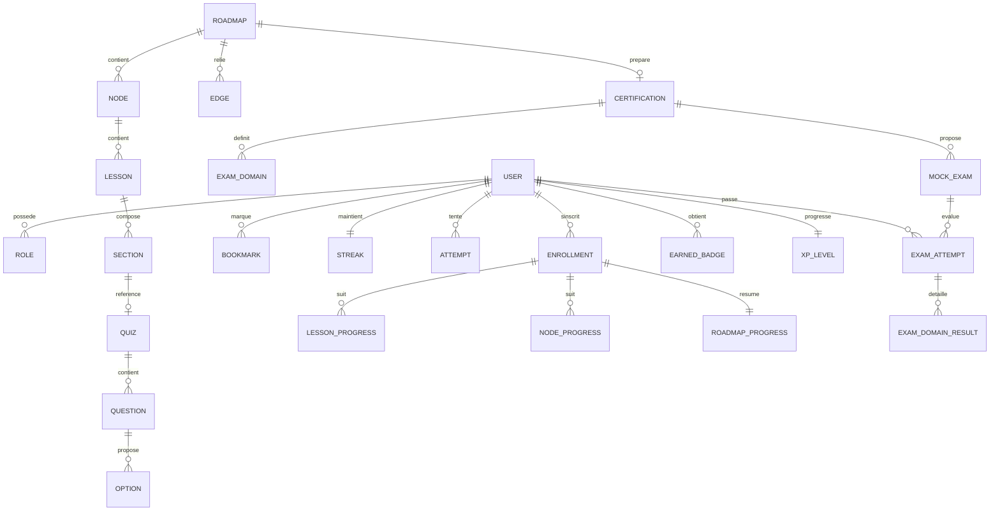

# SPÉCIFICATION PRODUIT — SkillForge

> **Statut :** document ancre (v1). Toute décision produit se réfère à ce fichier.
> En cas de conflit sur un détail métier, ce document prime sur `CLAUDE.md`.
> Les décisions purement techniques/architecturales sont détaillées dans
> `docs/ARCHITECTURE.md`.

---

## 1. Vision & proposition de valeur

**SkillForge** est une plateforme e-learning **100 % locale** (self-hébergée via Docker
Compose) qui accompagne un apprenant technique du niveau **débutant** au niveau
**professionnel** sur un ensemble de parcours d'ingénierie logicielle et cloud, ainsi que
sur des **certifications** reconnues (KCNA, CKA, CKAD).

**Le problème adressé.** L'apprentissage technique autonome est fragmenté : les roadmaps
(type roadmap.sh) montrent *quoi* apprendre mais pas *comment* ; les cours vidéo sont
linéaires et ne respectent pas le rythme réel de l'apprenant ; les plateformes de quiz ne
relient pas la pratique à une progression cohérente ; et rien ne consolide *une seule
trajectoire* de la découverte à la certification.

**La proposition de valeur.** SkillForge unifie en un seul produit :

1. **Des roadmaps interactives** (graphes de nœuds regroupés par phases) que l'on parcourt
   **librement, dans n'importe quel ordre**.
2. **Du contenu pédagogique structuré et rigoureux** par nœud (Concept, Schéma, Exemples
   de code, Exercice, Quiz), du fondamental au niveau professionnel.
3. **Une progression persistée côté serveur** qui permet de **quitter un nœud, aller
   ailleurs, revenir et retrouver exactement la dernière leçon consultée** — la reprise
   exacte est la fonctionnalité signature du produit.
4. **De l'évaluation sérieuse** : quiz corrigés, défis de code, et **examens blancs
   chronométrés** calqués sur les vraies certifications, avec score par domaine et
   détection des points faibles.
5. **De la gamification motivante** : XP, niveaux nommés (débutant → pro), badges, séries
   (streaks), tableaux de bord.

**Différenciateurs clés :** navigation non linéaire avec reprise exacte ; le **serveur
fait foi** pour la progression (jamais le localStorage) ; contenu ancré côté Java/Spring
quand c'est pertinent ; exécution intégrale en local (souveraineté des données, pas de
dépendance SaaS).

---

## 2. Personas

### P1 — Léa, apprenante débutante
- **Profil :** développeuse junior / en reconversion, découvre le backend et le cloud.
- **Besoins :** un point d'entrée clair, un fil conducteur, des explications qui ne
  supposent aucun prérequis, du feedback immédiat, le sentiment de progresser.
- **Frustrations :** se perdre dans l'ordre des sujets, ne pas savoir « où j'en étais »,
  abandonner faute de repères.
- **Ce que SkillForge lui apporte :** roadmap visuelle avec statuts, bandeau « Reprendre »,
  XP/badges qui matérialisent l'avancement, quiz de vérification.

### P2 — Marc, apprenant confirmé / en préparation de certification
- **Profil :** développeur ou ops expérimenté, vise KCNA/CKA/CKAD ou veut combler des
  lacunes ciblées (perf, sécurité API, Terraform).
- **Besoins :** aller directement aux nœuds utiles (navigation libre), s'auto-évaluer dans
  des conditions réalistes, identifier ses domaines faibles, réviser efficacement.
- **Frustrations :** re-suivre du contenu déjà maîtrisé, examens blancs peu représentatifs,
  absence de diagnostic par domaine.
- **Ce que SkillForge lui apporte :** examens blancs chronométrés par domaine, mode révision
  ciblée, tableau de bord de couverture, accès non linéaire.

### P3 — Sophie, instructrice / administratrice
- **Profil :** créatrice de contenu et/ou gestionnaire de la plateforme.
- **Besoins :** créer/éditer des parcours, leçons et quiz ; importer massivement du contenu
  (JSON pivot) ; gérer les utilisateurs et les rôles ; garder le catalogue à jour.
- **Frustrations :** outils d'authoring rigides, imports non idempotents, pas de
  prévisualisation.
- **Ce que SkillForge lui apporte :** espace admin, authoring de leçons/sections, ingestion
  idempotente par JSON pivot, gestion des rôles.

> **Rôles applicatifs :** `LEARNER` (P1, P2), `INSTRUCTOR` (authoring + ingestion),
> `ADMIN` (tout INSTRUCTOR + gestion utilisateurs/rôles + configuration).

---

## 3. Liste exhaustive des fonctionnalités

### 3.1 Comptes & authentification
- Inscription (email + mot de passe), connexion, déconnexion.
- Rôles : `LEARNER` / `INSTRUCTOR` / `ADMIN` (autorisation par rôle).
- Mots de passe hachés (BCrypt/Argon2). **JWT** access + refresh ; rafraîchissement.
- Profil utilisateur : nom d'affichage, avatar (optionnel), préférences (thème clair/sombre).
- Administration des utilisateurs (ADMIN) : lister, changer de rôle, activer/désactiver.

### 3.2 Catalogue de parcours (roadmaps) & navigation
- Catalogue listant **tous les parcours** avec la progression de l'utilisateur.
- Parcours techniques : Backend Developer, Software Design & Architecture, Docker,
  Kubernetes, Terraform, Rust, Prompt Engineering, AWS (bonnes pratiques), Backend
  Performance, API Security.
- Parcours transverse : **Développeur Backend Java**.
- Parcours de **certification** : KCNA, CKA, CKAD (associés aux domaines d'examen).
- Un parcours = un **graphe** : nœuds regroupés par **phases**, arêtes = prérequis
  **indicatifs et non bloquants**.
- Métadonnées par nœud : importance, durée estimée, certification associée, domaines
  d'examen + pondération le cas échéant.
- Recherche dans le catalogue et dans le contenu.

### 3.3 Apprentissage (cœur du produit)
- Inscription d'un apprenant à un parcours (enrollment).
- **Navigation non linéaire :** ouvrir n'importe quel nœud à tout moment, en sortir, aller
  ailleurs, revenir.
- **Reprise exacte par nœud :** retrouver la dernière leçon consultée dans ce nœud.
- **Reprise globale :** « reprendre là où j'en étais », tous parcours confondus (dernier
  nœud actif du dernier parcours actif).
- **Progression persistée en base** (le serveur fait foi) :
  - par **leçon** : vue / complétée ;
  - par **nœud** : % de complétion + dernière leçon consultée ;
  - par **parcours** : dernier nœud actif + % global.
- Favoris / marque-pages sur nœuds et leçons.
- Séries d'apprentissage (**streaks**) : jours consécutifs d'activité.

### 3.4 Contenu : leçons structurées
- Une **leçon** appartient à un nœud et se compose de **sections ordonnées typées** :
  - **Concept** (texte pédagogique rigoureux) ;
  - **Schéma** (SVG ou Mermaid) ;
  - **Exemple de code** (langage + snippet, coloration syntaxique) ;
  - **Exercice** (énoncé + solution repliable) ;
  - **Quiz** (référence vers le contexte Évaluation).
- Lecture côté apprenant ; **authoring** côté INSTRUCTOR/ADMIN (créer, éditer, réordonner,
  prévisualiser).
- **Ingestion** de contenu via **JSON pivot** (peuplement massif d'un nœud), idempotente.

### 3.5 Évaluation
- **Quiz** par leçon/nœud : questions (QCM, vrai/faux, scénario), options, bonne réponse,
  justification ; tentative + score ; correction immédiate.
- **Défis de code :** énoncé, squelette, solution attendue ; validation par comparaison aux
  points clés (**pas d'exécution de code côté serveur**) + feedback.
- **Examens blancs chronométrés** par certification :
  - KCNA : QCM, ~90 min ;
  - CKA / CKAD : tâches pratiques, ~2 h ;
  - minuteur, ensemble de questions/tâches, **score par domaine d'examen**, rapport des
    points faibles, historique des tentatives.
- **Mode révision ciblée :** ressert en priorité les domaines où l'apprenant est faible.

### 3.6 Gamification
- **XP** attribuée à la complétion (leçon, nœud, parcours, examen réussi).
- **Niveaux** explicites et nommés (paliers débutant → professionnel) selon l'XP cumulée
  et la couverture des parcours ; barème **paramétrable**.
- **Badges** : règles d'obtention (compléter un nœud/parcours, réussir un examen blanc,
  tenir une série de N jours, etc.).
- Attribution **orientée événements** (à la complétion d'une leçon/examen, on évalue et
  attribue XP/niveaux/badges), découplée du reste.

### 3.7 Tableaux de bord & analytics
- Progression par parcours ; **couverture des domaines** ; niveau / XP ; badges ; séries.
- **Recommandations** : prochaine étape suggérée, domaines à réviser.
- Historique des tentatives d'examen et évolution des scores.

### 3.8 Espace admin
- Gestion des parcours (création/édition, ingestion JSON pivot roadmap).
- Gestion du contenu (authoring leçons/sections, ingestion JSON pivot contenu).
- Gestion des utilisateurs et des rôles.

### 3.9 Recherche
- Recherche transverse dans le catalogue (parcours, nœuds) et dans le contenu (leçons).

---

## 4. Modèle conceptuel de haut niveau

Grands objets métier et relations (vue conceptuelle, non physique) :

- **User** — possède un ou plusieurs **Role**. Détient des **Credentials**.
- **Roadmap** (parcours) — contient des **Node** (nœuds) regroupés en **Phase**, reliés par
  des **Edge** (arêtes/prérequis indicatifs). Peut être associée à une **Certification**.
- **Certification** — définit des **ExamDomain** (domaines d'examen pondérés) et des
  **MockExam** (examens blancs).
- **Node** — contient des **Lesson** (leçons).
- **Lesson** — composée de **Section** ordonnées et typées (Concept, Schéma, Code, Exercice,
  Quiz). Une section Quiz référence un **Quiz**.
- **Quiz** — contient des **Question**, chacune avec des **Option** et une justification.
- **Enrollment** — lie un **User** à une **Roadmap** ; porte la **Progression** :
  - **LessonProgress** (vue/complétée) ;
  - **NodeProgress** (% + dernière leçon) ;
  - **RoadmapProgress** (dernier nœud actif + %).
- **Bookmark** — lie un **User** à un **Node** ou une **Lesson**.
- **Streak** — série d'activité d'un **User**.
- **Attempt** — tentative d'un **User** sur un **Quiz** (score).
- **ExamAttempt / ExamResult** — tentative d'un **User** sur un **MockExam**, avec score par
  **ExamDomain** et détection des points faibles.
- **XpLedger / Level** — XP cumulée et niveau d'un **User**.
- **Badge / EarnedBadge** — badges disponibles et badges obtenus par un **User**.

> Le modèle **physique** détaillé (tables, colonnes, types, index, migrations Flyway,
> `uuidv7()`) est produit ultérieurement dans le cadre du modèle de données et documenté
> avec l'architecture.

---

## 5. Découpage en contextes bornés (bounded contexts)

Monolithe **modulaire** : un seul déployable, des frontières nettes. Sept contextes, chacun
en architecture hexagonale.

| Contexte | Responsabilité | Justification de la frontière |
|---|---|---|
| **iam** | Utilisateurs, rôles, credentials, authentification (JWT), autorisation. | Sécurité et identité sont transverses mais doivent rester isolées : un seul point de vérité pour l'auth, réutilisé par tous. |
| **catalogue** | Roadmaps, phases, nœuds, arêtes, certifications, domaines d'examen ; ingestion des roadmaps. | Structure *statique* du savoir (le « quoi apprendre »), indépendante de la progression d'un utilisateur. |
| **contenu** | Leçons et sections typées (concept, schéma, code, exercice, quiz) ; authoring ; ingestion de contenu. | Le *contenu pédagogique* évolue à un rythme différent de la structure du catalogue et de l'évaluation ; l'authoring est un sous-domaine à part. |
| **apprentissage** | Inscriptions, progression (leçon/nœud/parcours), navigation non linéaire, reprise, favoris, streaks. | Cœur du produit ; centré sur l'*état d'un apprenant*, distinct du contenu qu'il consomme. |
| **evaluation** | Quiz, questions, tentatives, défis de code, examens blancs chronométrés, scoring par domaine, révision ciblée. | Logique de notation et d'examen complexe et autonome ; consomme le catalogue/contenu mais possède ses propres règles. |
| **gamification** | XP, niveaux nommés, badges, règles d'attribution orientées événements. | Règles de motivation *paramétrables*, découplées via événements des faits d'apprentissage/évaluation. |
| **analytics** | Tableaux de bord, couverture des domaines, recommandations, historique agrégé. | Lecture/agrégation transverse (CQRS-friendly) ; ne doit pas polluer les contextes sources avec des besoins de reporting. |

**Règles de dépendance (rappel, cf. `CLAUDE.md` §3) :** le domaine ne dépend de rien ;
les dépendances pointent vers l'intérieur ; un contexte n'accède jamais directement aux
tables d'un autre — il passe par un **port** ou un **service applicatif exposé**. La
communication `apprentissage`/`evaluation` → `gamification` se fait par **événements**.

---

## 6. Parcours utilisateur clés (user journeys)

### J1 — Première prise en main (Léa, LEARNER)
1. S'inscrit, se connecte.
2. Parcourt le catalogue, choisit « Backend Developer », s'y inscrit.
3. Ouvre la roadmap interactive, clique sur un nœud de son choix.
4. Lit une leçon (Concept → Schéma → Code → Exercice → Quiz), marque « leçon terminée ».
5. Gagne de l'XP, voit sa progression et son niveau évoluer.

### J2 — Navigation libre + reprise exacte (fonctionnalité signature)
1. Marc ouvre le nœud « Caching », consulte la leçon 3.
2. Il quitte, va sur un autre parcours (« API Security »), consulte 2 leçons.
3. Il revient sur « Caching » → **réouverture exacte à la leçon 3**.
4. Depuis n'importe quel écran, « Reprendre » le ramène à sa **dernière activité globale**.

### J3 — Préparation & passage d'examen blanc (Marc, certification)
1. Ouvre le parcours de certification (ex. CKAD), lance un **examen blanc chronométré**.
2. Le minuteur tourne ; il navigue entre les tâches/questions.
3. À la fin : **score par domaine**, points faibles identifiés, historique mis à jour.
4. Active le **mode révision ciblée** sur ses domaines faibles.

### J4 — Authoring & ingestion (Sophie, INSTRUCTOR/ADMIN)
1. Crée/édite un parcours, ou **importe un JSON pivot roadmap** (idempotent).
2. Ajoute des leçons et sections à un nœud, ou **importe un JSON pivot contenu**.
3. Prévisualise le rendu.
4. (ADMIN) gère les utilisateurs et leurs rôles.

### J5 — Pilotage de sa progression (tout LEARNER)
1. Ouvre son tableau de bord : progression par parcours, couverture des domaines, niveau/XP,
   badges, séries.
2. Suit les **recommandations** de prochaine étape / révision.

---

## 7. Attributs de qualité visés & hypothèses

### Attributs de qualité
- **Performance / scalabilité :** stack **réactive de bout en bout** (WebFlux + R2DBC), non
  bloquante ; index sur FK et colonnes de tri/filtre ; UUID v7 (ordonnés, index-friendly).
  Cible : usage local mono-instance fluide pour un petit nombre d'utilisateurs simultanés,
  API réactives sans `.block()`.
- **Sécurité :** auth JWT stateless (access + refresh) ; mots de passe hachés ; autorisation
  par rôle ; validation des entrées au bord ; pas de secret en dur ; pas de stacktrace
  renvoyée au client (handler d'erreurs global).
- **Maintenabilité :** monolithe modulaire hexagonal, domaine pur et testable en unitaire ;
  frontières explicites entre contextes ; conventions figées (nommage, API, erreurs).
- **Testabilité :** domaine testé en unitaire (rapide) ; adaptateurs via Testcontainers
  (PostgreSQL 18) ; scénarios critiques (reprise exacte, scoring, sécurité) couverts.
- **Accessibilité (front) :** palette violet/bleu/blanc, contrastes **WCAG AA**, mode
  clair/sombre.
- **Portabilité / souveraineté :** exécution intégrale en local via Docker Compose ; aucune
  dépendance à un SaaS externe au runtime.
- **Fiabilité de la progression :** le **serveur fait foi** — le localStorage n'est jamais
  source de vérité.

### Hypothèses
- Déploiement **local mono-instance** (pas de haute dispo / multi-région au MVP).
- Nombre d'utilisateurs simultanés modeste (usage personnel/équipe/formation).
- Les **défis de code ne sont pas exécutés côté serveur** (validation par comparaison aux
  points clés) — pas de sandbox d'exécution au MVP.
- Le contenu pédagogique est produit hors-ligne au **format JSON pivot** puis ingéré.
- Les **prérequis (arêtes) sont indicatifs** : ils n'empêchent jamais l'accès à un nœud.
- Pas de paiement, pas de multi-tenant, pas de notifications externes (email/push) au MVP.

---

## 8. Périmètre : MVP vs plus tard

### Dans le MVP
- **iam** complet : register / login / refresh / logout / me + admin utilisateurs.
- **catalogue** : modèle graphe + endpoints de lecture + **ingestion JSON pivot roadmap**
  (idempotente) ; les 10 roadmaps + parcours Java + certifs entrent dans le modèle.
- **contenu** : leçons/sections typées, lecture + authoring + **ingestion JSON pivot
  contenu**.
- **apprentissage** : enrollment, navigation non linéaire, **reprise exacte (nœud + globale)**,
  progression persistée (leçon/nœud/parcours), favoris, streaks.
- **evaluation** : quiz corrigés, défis de code (validation par points clés), **examens
  blancs chronométrés** avec score par domaine + points faibles + historique, révision
  ciblée.
- **gamification** : XP, niveaux nommés, badges (règles paramétrables, orientées événements).
- **analytics** : tableau de bord (progression, couverture, niveau/XP, badges, séries) +
  recommandations de base.
- **Front React** : design system (violet/bleu/blanc, clair/sombre, WCAG AA), shell + auth,
  expérience d'apprentissage (catalogue, roadmap interactive, nœud, leçon), évaluations +
  simulateur d'examen + dashboards.
- **Déploiement local** : Docker Compose (PostgreSQL 18 + backend + front), migrations
  Flyway au démarrage, **seed de démo** (un admin, un apprenant, un petit parcours).
- **Tests & CI** : unitaires domaine, intégration Testcontainers, e2e front minimal, CI
  build + tests.

### Plus tard (hors MVP)
- Exécution réelle des défis de code (sandbox / conteneurs éphémères).
- Recommandations avancées (moteur adaptatif, spaced repetition élaboré).
- Notifications (email/push), rappels de streak.
- Import/export de progression, partage social, classements.
- Multi-instance / haute disponibilité, multi-tenant.
- Éditeur de roadmap visuel (drag & drop) côté admin.
- Internationalisation au-delà du français.
- Intégrations externes (OAuth tiers, SSO, LTI).

---

> **Prochain document ancre :** `docs/ARCHITECTURE.md` (architecture technique, découpage
> hexagonal détaillé, conventions transverses, ADR) — dérivé de cette spécification.
